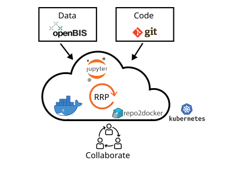

# Reproducible Research Platform

## Introduction
The Reproducible Research Platform (RRP) is an integrated platform for reproducible and executable data storage and analysis. It links data stored in the research data management system [openBIS](https://openbis.ch/) with analysis scripts, code and computational environment definitions managed with Git (using platforms such as GitLab or GitHub). Reproducible computational environments are created from the code repository with the open-source tools Docker and repo2docker. Computational environments can be accessed by users with the JupyterLab interface, which directly mounts the relevant datasets stored in openBIS. In addition, RRP allows collaborative sharing of computational environments, including datasets, with colleagues inside the research group. Technically, RRP is built on Kubernetes to provide scalable and dynamic allocation of computing resources.

## Documentation
A user documentation is provided [here](RRP-User-Documentation.pdf). More detailed technical documentation will be provided at a later stage.

## Requirements and setup
RRP is built on top of Kubernetes. A functional and properly configured Kubernetes cluster is therefore a prerequisite for installing RRP. At ETH Zurich, we use a custom Kubernetes cluster provided by the IT Services of ETH Zurich. As other Kubernetes deployments are likely to differ significantly in terms of customization, we currently do not provide detailed step-by-step installation instructions. Another important prerequisite is a running and fully configured openBIS server, as RRP relies on openBIS for authentication and storage of projects and results.

In general, for any deployment, the following steps need to be adressed by an experienced developer or admin: 
- build the Docker images of RRP components
- push them to a Docker registry that is available for the execution environment (i.e. your Kubernetes cluster)
- configure the Kubernetes cluster to fit your use case (in particular storage classes and connectivity with openBIS)
- deploy [ArgoCD](https://argo-cd.readthedocs.io/en/stable/) to the Kubernetes cluster (optional, but recommended)
- create a Kustomize configuration for your deployment

A more detailed technical description of our current deployment can be provided upon request. 

## Authors
Scientific IT Services, ETH Zurich
