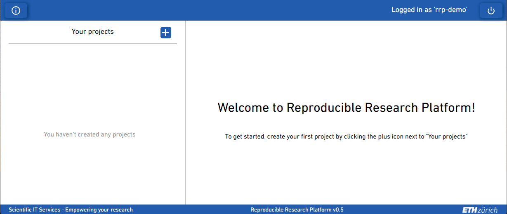
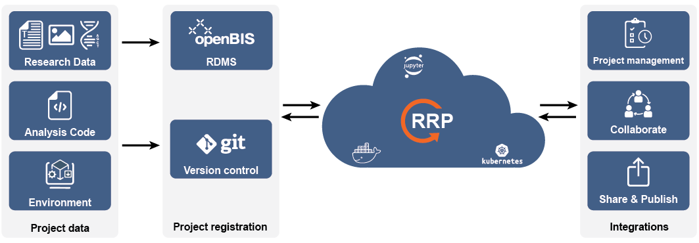
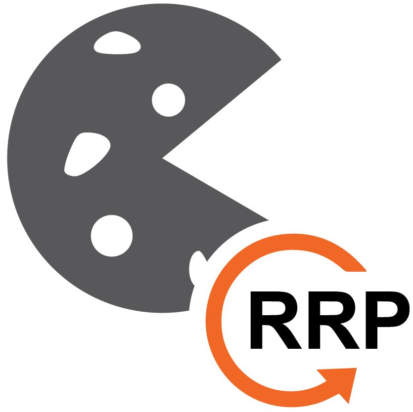
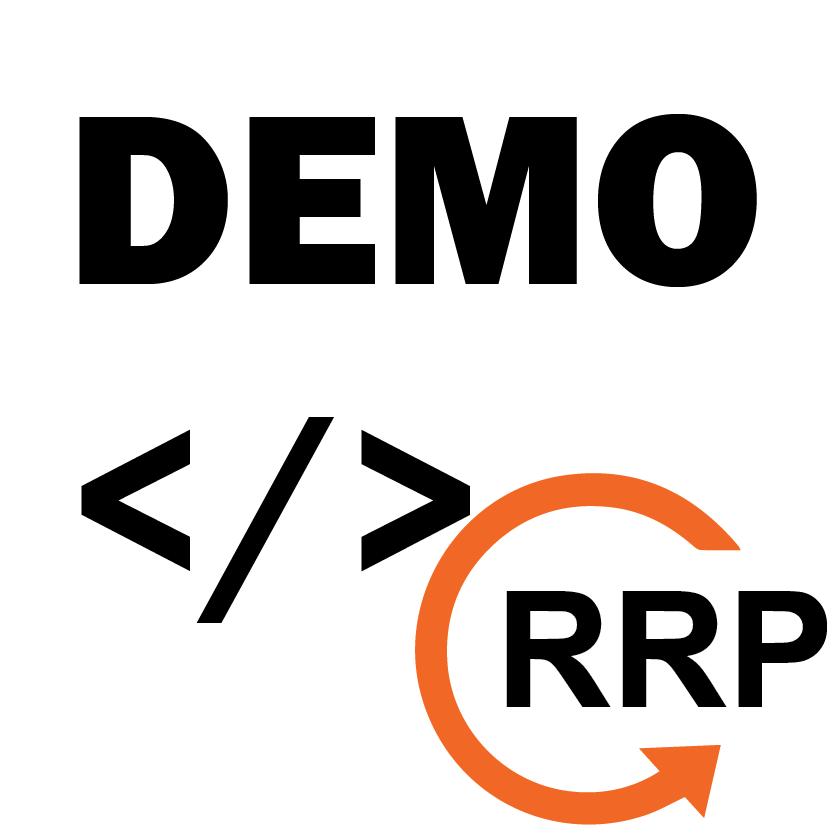

[](
https://sis.id.ethz.ch/)
[](https://spdx.org/licenses/Apache-2.0.html)
[](https://rrp.ethz.ch)

[](https://doi.org/10.3929/ethz-c-000787491)

#  Reproducible Research Platform (RRP)




## Introduction
The **Reproducible Research Platform** (**RRP**) bridges the research data and code life cycles. The platform allows to create FAIR research projects. It links data stored in the research data management system (RDMS) [openBIS](https://openbis.ch/) with analysis scripts, code and computational environment definitions managed with Git (using platforms such as GitLab or GitHub) making them executable anywhere by anyone. Reproducible computational environments are created from the code repository with the open-source tools Docker and repo2docker. Computational environments can be accessed by users with various interfaces such as the popular JupyterLab interface, which directly mounts the relevant datasets stored in the RDMS via tracable permanent identifiers. In addition, **RRP** allows collaborative sharing of **RRP projects** including datasets and the computational environment anytime with colleagues inside a research group or when exported as self-contained executable container. Such container can run on any platform and ensures reproducibility, long-term preservation of a research project and facillitates the reuse of prior work. The user experience can be customized at the **RRP project** level via various integrations (e.g. to support LaTex Editors, IDEs such as VS Code, R-Studio, MATLAB or full Linux Desktop). Technically, RRP is built on Kubernetes to provide scalable and dynamic allocation of computing resources.



## Documentation
A user documentation is provided [here](https://rrp.ethz.ch). It includes detailed documentation, cookiecutter templates and demo projects illustrating different use cases and integrations [See Demos](https://rrp.ethz.ch/docs/rrp-use-cases).


*  [RRP Cookiecutter Template Project](https://git.bsse.ethz.ch/rrp-examples/rrp-min)
*  [RRP Demo Project](https://sissource.ethz.ch/sispub/reproducible-research-platform-demo-project)

## System Requirements

### Hardware requirements

**RRP** itself requires only a standard computer with e.g.

```
4+ CPU
8+ GB RAM 
```
and can therefore run on a personal computer. However **RRP** is meant to run on a server or cluster to provide sufficient computational resources to individual **RRP projects** of the users.

### Software requirements

#### OS Requirements

**RRP** can be deployed on _macOS_ and _Linux_ or _Windows_. See [RRP Platform Demo](https://sissource.ethz.ch/sispub/reproducible-research-platform-demo) for detailed deployment instructions. RRP has been tested on the following systems:

```Bash
macOS: Sequoia (15+)
Linux: Ubuntu 24.04.3 LTS
Windows: 10 and 11
```

#### Dependencies

The **RRP** backend is written in Scala with adapter code in Java. Whereas the front-end is written in TypeScript using React for the UI. depends on the Python scientific stack.

```Scala
Scala (version 3.1.3)
TypeScript (version 4.4.2)
Java (version 17)
React (version 17.0.1)
repo2docker (version 2024.03.0) 
Kubernetes cluster (version 1.31.7) 
Apache (version 2.4.52)
```

#### General setup
**RRP** is built on top of Kubernetes. A functional and properly configured Kubernetes cluster is therefore a prerequisite for installing **RRP**. At ETH Zurich, we use a custom Kubernetes cluster provided by the IT Services of ETH Zurich. Another important prerequisite is a running and fully configured openBIS server, as **RRP** relies on openBIS for authentication and storage of projects and results.

In general, for any deployment, the following steps need to be adressed by an experienced developer or admin: 
- build the Docker images of **RRP** components
- push them to a Docker registry that is available for the execution environment (i.e. your Kubernetes cluster)
- configure the Kubernetes cluster to fit your use case (in particular storage classes and connectivity with openBIS)
- deploy [ArgoCD](https://argo-cd.readthedocs.io/en/stable/) to the Kubernetes cluster (optional, but recommended)
- create a Kustomize configuration for your deployment

A more detailed technical description of our current deployment can be found in our accompanying paper. 

To simplyfy the build process on any major system (_macOS_, _Linux_, _Windows_) we provide step-by-step instructions for direct testing, see [Reproducible Research Platform Demo](https://sissource.ethz.ch/sispub/reproducible-research-platform-demo). 

Further technical details can be provided upon request.

## Get started

To deploy the **RRP** (the platform) and test it locally or on a server on any major system _(macOS_, _Linux_, _Windows_), we simplified the build process and provide step-by-step instructions and setup scripts:

* Go to [Reproducible Research Platform Demo](https://sissource.ethz.ch/sispub/reproducible-research-platform-demo) 

The build process time of **RRP** depends on the hardware, but takes less than `10 mins` for the deployment and around `1-2` minutes to start (e.g. on a Windows 11 Laptop, version 10.0.261100 Build 26100 with 8 CPU cores @3.3 GHz/core and 16GB RAM). 

Building **RRP projects** on the **RRP** again depends on the hardware **RRP** is running on and on the complexity of the computational depencencies of the **RRP project** and can take from a `couple of minutes` (e.g [RRP Demo project](https://sissource.ethz.ch/sispub/reproducible-research-platform-demo-project)) to `several mintues` (e.g. [RRP TracX with MATLAB](https://git.bsse.ethz.ch/rrp-examples/rrp-tracx)). However, once an **RRP project** is built, it starts in a `couple of seconds`. And if a project is shared via the share identifier other users do not have to build it and can start it also within `seconds`.

## License

RRP is covered under the **Apache 2.0 License**.


## Authors

Antti Luomi, Andreas P. Cuny, Henry Lütcke 

Scientific IT Services, ETH Zurich
